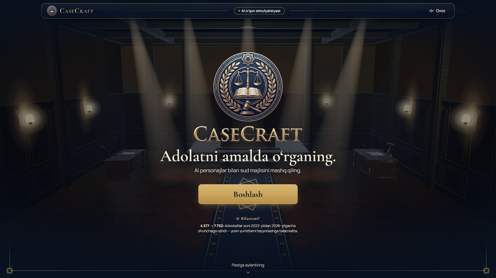
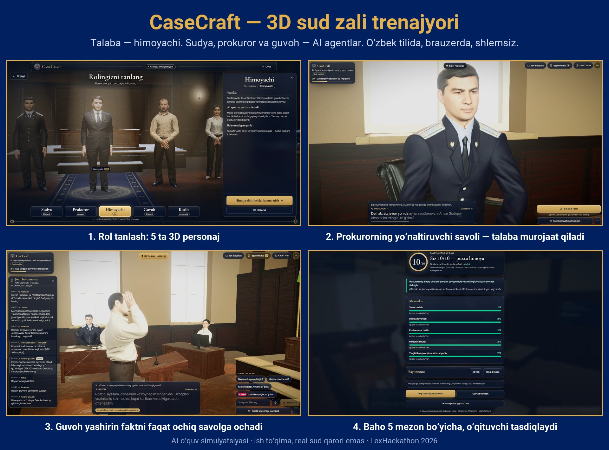

# CaseCraft — sud trenajyori





AI asosidagi o'quv simulyatsiyasi: talaba himoyachi rolida, sudya, prokuror va guvoh — AI. 3D sud zali, ovozli
muloqot (STT/TTS), o'qituvchi paneli. Bu real sud qarori emas.

| Papka | Tarkibi |
|---|---|
| `server/` | Backend — FastAPI, Gemini/Anthropic LLM, edge-tts. Batafsil: [server/README.md](server/README.md) |
| `web/` | Frontend — Vite, React, three.js (3D zal, kirish, o'qituvchi paneli) |
| `content/` | Ish materiallari, qoidalar, testlar (JSON) |

## Ishga tushirish

**Docker bilan (tavsiya etiladi):**

```bash
cp server/.env.example server/.env    # GEMINI_API_KEY ni yozing
docker compose up -d --build          # http://localhost:8080
```

Batafsil: [DOCKER.md](DOCKER.md).

**Windows, Docker'siz:** `ISHGA_TUSHIRISH.bat` — qo'llanma: [ISHGA_TUSHIRISH.md](ISHGA_TUSHIRISH.md).

**Qo'lda:**

```bash
cd server && pip install -r requirements.txt && uvicorn app.main:app --port 8000
cd web && npm ci && npm run dev       # http://localhost:5173/intro.html
```
